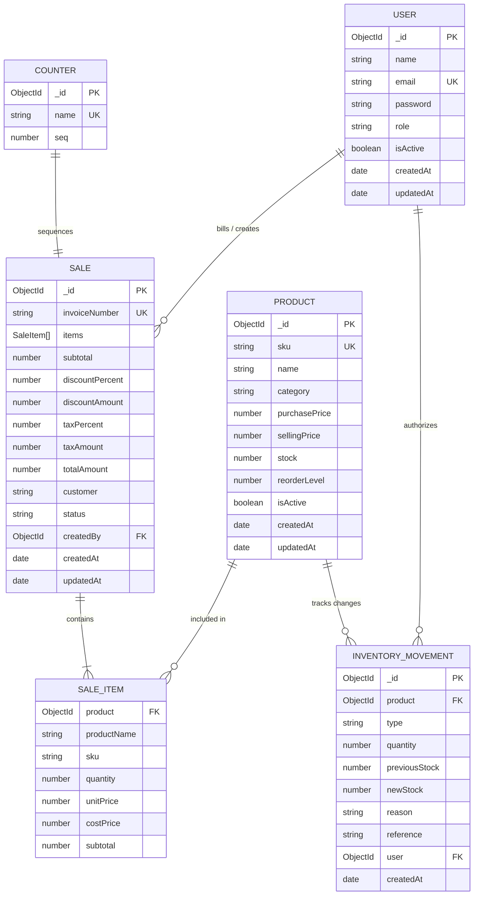

# StockWise Database Architecture & Schema Reference

This document outlines the complete MongoDB database architecture, collections, entity relationships, validation rules, and indexing strategy for StockWise.

---

## 1. Entity-Relationship Diagram (ERD)

---

## 2. Collections & Field Specifications

### 2.1 `users` Collection
Stores administrator and cashier credentials with bcrypt password hashing.
- **`name`** (String, required): User's full name.
- **`email`** (String, required, unique, indexed): Login email.
- **`password`** (String, required, select: false): Bcrypt hashed password (10 salt rounds).
- **`role`** (String, enum: `['admin', 'staff']`, default: `'staff'`): RBAC permission level.
- **`isActive`** (Boolean, default: `true`): Soft deactivation toggle.

### 2.2 `products` Collection
Stores the retail product catalog, pricing, and live inventory levels.
- **`sku`** (String, required, unique, uppercase, indexed): Stock Keeping Unit identifier (e.g. `ELEC-001`).
- **`name`** (String, required, indexed text): Product display title.
- **`category`** (String, required, indexed): Product classification (e.g. `Electronics`, `Grocery`).
- **`purchasePrice`** (Number, required, min: 0): Wholesale / cost price for COGS analysis.
- **`sellingPrice`** (Number, required, min: 0): Retail price charged to customers.
- **`stock`** (Number, required, default: 0, min: 0): Available stock units on shelf.
- **`reorderLevel`** (Number, required, default: 10, min: 0): Threshold triggering low-stock alerts.
- **`isActive`** (Boolean, default: `true`): Soft delete flag.

### 2.3 `sales` Collection
Stores immutable sales orders, invoice details, item snapshots, and payments.
- **`invoiceNumber`** (String, required, unique): Sequential invoice code (e.g. `INV-00001`).
- **`items`** (Array of embedded SaleItem subdocuments):
  - `product` (ObjectId, ref: Product)
  - `productName` (String): Snapshot of name at time of purchase.
  - `sku` (String): Snapshot of SKU at time of purchase.
  - `quantity` (Number, min: 1): Units purchased.
  - `unitPrice` (Number): Selling price at time of purchase.
  - `costPrice` (Number): Purchase/cost price at time of purchase.
  - `subtotal` (Number): `unitPrice * quantity`.
- **`subtotal`** (Number): Sum of item subtotals.
- **`discountPercent`** (Number, 0-100): Percentage discount applied.
- **`discountAmount`** (Number): Absolute discount value.
- **`taxPercent`** (Number): GST percentage applied.
- **`taxAmount`** (Number): Absolute tax value.
- **`totalAmount`** (Number): Grand payable amount.
- **`customer`** (String): Customer name or phone.
- **`status`** (String, enum: `['completed', 'returned']`): Order lifecycle status.
- **`createdBy`** (ObjectId, ref: User): Staff/Admin who generated the invoice.

### 2.4 `inventorymovements` Collection
Audit ledger logging every inward shipment, sale, return, and stock adjustment.
- **`product`** (ObjectId, ref: Product, required).
- **`type`** (String, enum: `['received', 'adjustment', 'sale', 'return']`).
- **`quantity`** (Number): Units changed (+ for increase, - for decrease).
- **`previousStock`** (Number): Stock before adjustment.
- **`newStock`** (Number): Stock after adjustment.
- **`reason`** (String): Audit memo / PO number.
- **`reference`** (String): Invoice number or Adjustment ID.
- **`user`** (ObjectId, ref: User): User who authorized movement.

### 2.5 `counters` Collection
Atomic sequence generator ensuring strictly incremental, collision-free invoice numbers across concurrent POS terminals.
- **`name`** (String, unique): Counter sequence key (`invoice`).
- **`seq`** (Number): Atomic auto-incrementing integer.

---

## 3. High-Performance Indexing Strategy

| Collection | Indexed Fields | Index Type | Query Optimization |
| :--- | :--- | :--- | :--- |
| `products` | `{ name: 'text', sku: 'text' }` | Text Search | Full-text searching on name & SKU |
| `products` | `{ category: 1, isActive: 1 }` | Compound | Fast category filtering |
| `products` | `{ isActive: 1, stock: 1 }` | Compound | Instant low-stock / out-of-stock detection |
| `products` | `{ createdAt: -1 }` | Single B-Tree | Fast sorting by creation date |
| `sales` | `{ invoiceNumber: 1 }` | Unique | Instant $O(1)$ invoice lookup |
| `sales` | `{ createdAt: -1 }` | Single B-Tree | Chronological sales history queries |
| `sales` | `{ status: 1, createdAt: -1 }` | Compound | Daily aggregation & profit reports |
| `inventorymovements`| `{ product: 1, createdAt: -1 }` | Compound | Product-specific movement audit timeline |
| `inventorymovements`| `{ type: 1, createdAt: -1 }` | Compound | Movement filtering by received/sale/return |
