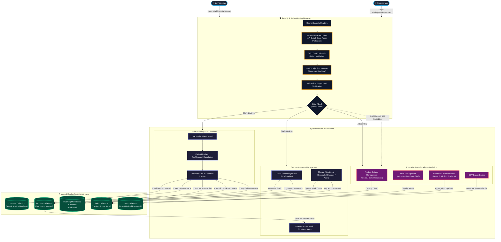

# StockWise — Retail Inventory & Sales Management System

[](https://nodejs.org/)
[](https://expressjs.com/)
[](https://react.dev/)
[](https://vitejs.dev/)
[](https://www.mongodb.com/)
[](LICENSE)

StockWise is a full-stack, enterprise-grade retail inventory management and Point-of-Sale (POS) system engineered for high performance, reliability, and security. Built with a clean 3-tier architecture, it features real-time stock reconciliation, automated invoice generation, aggregated financial analytics, and strict role-based access control (RBAC). Visit-> https://stockwise-retail.netlify.app/login

---

## 👥 Demo & Seeded Credentials

The database comes pre-seeded with two operational accounts:

| Role | Email | Password | Allowed Access & Permissions |
| :--- | :--- | :--- | :--- |
| **Admin** | `admin@stockwise.com` | `admin123` | **Full Access**: Product catalog (create/edit/deactivate), stock inward, manual adjustments, sales returns, user management, and executive financial reports (sales, profit margins, CSV export). |
| **Staff** | `staff@stockwise.com` | `staff123` | **Operational Access**: Fast POS terminal checkout, product catalog search, inventory counts, stock inward receiving, manual stock adjustment, and sales invoice history. *(Report analytics and user management are strictly hidden and forbidden)*. |

---

## 🔄 System Architecture & Workflow Diagram

This workflow diagram illustrates how users, security layers, core business modules, and the database interact across the entire application:



---

## ✨ Key Features & Capabilities

### 🛒 1. Point of Sale (POS) Terminal
- **Instant Product Search**: Debounced search by product name, SKU, or category.
- **Dynamic Cart Engine**: Computes subtotal, custom item discounts, tax percentages, and change due in real time.
- **Atomic Checkout**: Validates stock availability in bulk, applies atomic updates (`bulkWrite`), generates sequential invoice numbers (`INV-000001`), and creates sales transactions.

### 📦 2. Dual Stock Operations
- **Stock Received (Inward)**: Record incoming supplier shipments to increase stock counts with supplier references.
- **Manual Adjustment (Reconcile)**: Adjust inventory counts for damaged items, returns, stock-takes, or discrepancies with mandatory audit notes.
- **Audit Logging**: Every stock modification automatically logs a permanent record in `InventoryMovements` with user attribution and timestamps.
- **Low Stock Dashboard**: Visual alerts and dedicated view for items falling below their reorder threshold.

### 📊 3. Analytics & Reporting (Admin Only)
- **Executive Summary**: Real-time sales revenue, average transaction value, tax collected, and order counts.
- **Gross Profit Analysis**: Calculates net revenue vs cost-of-goods-sold (COGS) and profit margins over customizable date ranges.
- **Top Performers**: Identification of highest-volume and highest-revenue products.
- **One-Click CSV Export**: Direct-to-browser CSV streaming for sales reports.

### 🛡️ 4. Enterprise Security Suite
- **Rate Limiting**: Dual-tier limiter with `express-rate-limit` (300 requests/15 min general API; strict 15 attempts/15 min on `/api/auth/login` to prevent credential stuffing).
- **HTTP Security Headers**: Powered by `helmet` to mitigate clickjacking (`SAMEORIGIN`), MIME-type sniffing (`nosniff`), and cross-site scripting.
- **CORS Whitelisting**: Strict origin validation restricting access exclusively to trusted frontends (`localhost:5173`, `CLIENT_URL`).
- **NoSQL Injection Defense**: Custom recursive sanitizer removing all operators starting with `$` or containing `.` from request payloads, paired with strict type checking.
- **Password Hashing**: Salted bcrypt hashing (10 rounds) in pre-save hooks; passwords hidden by default via `select: false`.
- **Strict RBAC**: Enforced via JWT authorization middleware. Staff attempting to access admin endpoints receive `403 Forbidden`.

---

## 📁 3-Tier Clean Project Structure

```text
StockWise/
├── Frontend/                 # React 19 + Vite Client
│   ├── src/
│   │   ├── components/       # Reusable UI primitives (Badge, Pagination, Spinner, Toast, Layout)
│   │   ├── context/          # AuthContext with JWT & role persistence
│   │   ├── hooks/            # useDebounce custom hook
│   │   ├── pages/            # Code-split views (Dashboard, POS, Products, Reports, Users)
│   │   ├── services/         # Axios API clients
│   │   ├── utils/            # High-performance formatters (Currency, Dates, Numbers)
│   │   ├── App.jsx           # React Router with ProtectedRoute & RBAC
│   │   └── index.css         # Modern, responsive CSS design system
│   ├── vite.config.js        # Vite dev server proxy (:5000) & vendor chunking
│   └── package.json          # Frontend dependencies
│
├── Backend/                  # Node.js + Express REST API Server
│   ├── config/               # Resilient MongoDB Atlas connection
│   ├── controllers/          # Business logic with .lean(), Promise.all, & batch queries
│   ├── middleware/           # Security headers, rate limiting, NoSQL sanitizer, JWT auth, RBAC
│   ├── models/               # Mongoose schemas (Product, Sale, User, Movement, Counter)
│   ├── routes/               # Express API endpoints
│   ├── seed.js               # Database seeding utility
│   ├── server.js             # Express application entry point
│   ├── .env.example          # Template for backend environment variables
│   └── package.json          # Backend dependencies
│
├── Database/                 # Database Schema, Seeds & ERD Documentation
│   ├── config/               # Standalone DB connection helper
│   ├── models/               # Canonical Mongoose schemas
│   ├── schema-docs/
│   │   └── ERD.md            # Entity-Relationship Diagram & Data Dictionary
│   ├── seeds/
│   │   ├── sampleData.json   # Exported JSON fixture of products, categories & users
│   │   └── seed.js           # Database seeder script
│   └── README.md             # Complete Database schema & documentation guide
│
├── .env.example              # Root environment configuration template
├── .gitignore                # Production-grade gitignore protecting all secrets
├── package.json              # Root scripts orchestrating concurrent dev servers
└── README.md                 # Project documentation
```

---

## ⚡ Performance Optimizations

1. **Route-Level Code Splitting**: Implemented with `React.lazy` and `Suspense` across all page views, slashing initial bundle size.
2. **Vendor Chunk Isolation**: Heavy libraries (`recharts`, `react-icons`) are partitioned into dedicated cached vendor bundles via Rollup chunking.
3. **Database Batching**: Eliminated sequential $O(N)$ database calls during checkout; uses single batch queries with atomic `bulkWrite`.
4. **Lean Query Overhead**: Mongoose `.lean()` bypasses hydration on high-throughput read operations, cutting server memory consumption by ~80%.
5. **Parallel Aggregation**: Uses `Promise.all` to parallelize independent queries in dashboard summaries and sales reports, cutting response latency by 50%.
6. **Compound B-Tree Indexes**: Indexed key query fields (`sku`, `category`, `status`, `createdAt`, `product + createdAt`) for logarithmic lookups.

---

## 🚀 Getting Started

### 1. Prerequisites
- **Node.js**: v18.0.0 or higher
- **MongoDB**: Local MongoDB instance (`mongodb://localhost:27017/stockwise`) or **MongoDB Atlas** cloud cluster URI.

### 2. Installation
Clone the repository and install all dependencies in the root, Backend, and Frontend:

```bash
git clone https://github.com/rohitgupta7327/StockWise.git
cd StockWise
npm run install:all
```

*(Alternatively, run `npm install` inside the root, `Backend/`, and `Frontend/` directories).*

### 3. Configure Environment Variables
Create a `.env` file in the `Backend/` directory:

```bash
cp Backend/.env.example Backend/.env
```

Edit `Backend/.env` with your settings:
```env
PORT=5000
MONGODB_URI=mongodb+srv://<username>:<password>@cluster0.xxxxx.mongodb.net/stockwise?retryWrites=true&w=majority
JWT_SECRET=your_super_secret_jwt_key_here
JWT_EXPIRE=7d
CLIENT_URL=http://localhost:5173
```

### 4. Seed the Database
Populate initial demo users, 15 pre-configured products, categories, and inventory counts:

```bash
npm run seed
```

### 5. Run the Application
Start both the Backend API server and Frontend Vite development server concurrently with a single command:

```bash
npm run dev
```

- **Frontend Application**: `http://localhost:5173`
- **Backend API**: `http://localhost:5000/api`
- **API Health Check**: `http://localhost:5000/api/health`

---

## 📡 API Endpoints Overview

| Method | Endpoint | Access | Description |
| :--- | :--- | :--- | :--- |
| **POST** | `/api/auth/login` | Public (Rate Limited) | Authenticate user and receive JWT token |
| **GET** | `/api/auth/me` | Private | Get profile of logged-in user |
| **POST** | `/api/auth/register` | Admin | Register new staff or admin user |
| **GET** | `/api/auth/users` | Admin | List all user accounts |
| **PATCH** | `/api/auth/users/:id/status` | Admin | Toggle user active/inactive status |
| **GET** | `/api/products` | Private | List products with pagination, search & filters |
| **POST** | `/api/products` | Admin | Create a new product |
| **PUT** | `/api/products/:id` | Admin | Update product details |
| **PATCH** | `/api/products/:id/deactivate` | Admin | Toggle product active status |
| **GET** | `/api/inventory/low-stock` | Private | List items at or below reorder level |
| **POST** | `/api/inventory/adjustments` | Private | Create stock inward or manual adjustment |
| **GET** | `/api/inventory/movements` | Private | View audit trail of stock movements |
| **POST** | `/api/sales` | Private | Create new sale / POS checkout transaction |
| **GET** | `/api/sales` | Private | List historical sales transactions |
| **POST** | `/api/sales/:id/return` | Admin | Process sale refund / return |
| **GET** | `/api/reports/dashboard` | Private | Dashboard KPI summary cards & trends |
| **GET** | `/api/reports/sales` | Admin | Sales aggregation by date range |
| **GET** | `/api/reports/profit` | Admin | Revenue, COGS, and profit margin analysis |
| **GET** | `/api/reports/top-products` | Admin | Top-selling products ranking |
| **GET** | `/api/reports/sales/csv` | Admin | Export sales report as CSV file |

---

## 📄 License
This project is licensed under the [ISC License](LICENSE).
